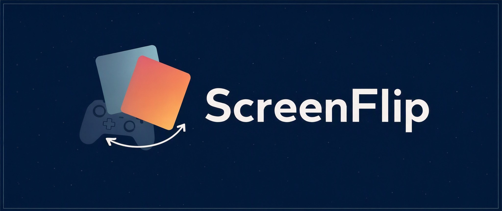

  

A dual-screen task-swap utility for the **AYN Thor**.

ScreenFlip swaps the top apps running on the two physical displays through
the OEM `PServerBinder` root shell — no accessibility service, no root, no
overlays!

## Features

- **Three swap modes**
  - **Swap** — exchange the top apps of both screens
  - **Top → bottom** — move the top screen's app to the bottom screen
  - **Bottom → top** — move the bottom screen's app to the top screen
- **Per-trigger actions** — the mode is configured separately for the main
  triggers (notification / tile / in-app button) and for the AYN double-tap
- **Triggers**
  - Three independent actions in the foreground-service notification
  - Quick Settings tile (shows the app name + the current default mode as
    the status line)
  - Double-tap of the physical AYN / Dual-Screen button (within 0.5 s, off
    by default)
- **Light / dark / system theme** with persistence
- **PServer diagnostics** — one-tap check that the OEM swap backend is
  present on the device

## How it works

1. Resolves the bottom display id at runtime (`am display id` +
   `DisplayManager` — ids are not stable across reboots).
2. Probes the top task id of each display out of `dumpsys activity
   activities` with a short `awk` pipeline (the vendor shell truncates
   commands longer than ~256 chars, so each probe stays far below that).
3. Moves the tasks with `am display move-stack <task> <display>`.

## Requirements

- AYN Thor with the **Odin** firmware (the `PServerBinder` service must be
  present — the in-app diagnostics section verifies this)
- Android 13+ (minSdk 33)

## Installation

  

1. Install the signed release APK (`app-release.apk`), or tap the badge
   above to add this repository to Obtainium for automatic updates.
2. Open ScreenFlip and grant the notification permission if prompted.
3. (Optional) Enable **Double-tap the AYN button** in the Triggers section.

## Usage

| Trigger | Action |
| --- | --- |
| Notification buttons | Run exactly **Swap** / **Top → bottom** / **Bottom → top** |
| QS tile tap | Runs the **main** configured mode |
| AYN double-tap | Runs the **AYN** configured mode |

## Notes & limitations

- A moved task is re-homed but not force-focused: on a display where a
  third-party launcher (e.g. NeoStation) owns the foreground, the moved app
  may sit behind the launcher until opened from recents. This is launcher
  behavior, not a ScreenFlip bug.
- The vendor `PServer` shell is heavily constrained (length limit, no
  command substitution, first-line output only). All swap logic therefore
  lives in Kotlin; the shell only ever runs short single-line commands.

## Support

If ScreenFlip is useful to you, you can support its development:
[https://boosty.to/stezkoy](https://boosty.to/stezkoy)
