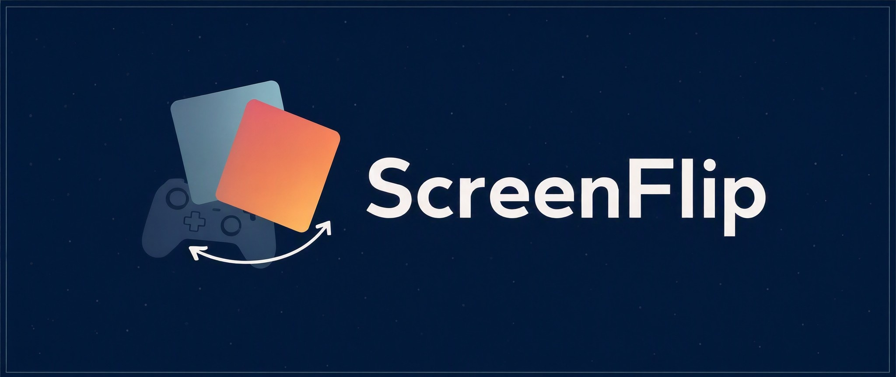

  

Утилита для обмена приложениями между двумя экранами **AYN Thor**

ScreenFlip перемещает верхние приложения с одного физического дисплея на
другой через OEM-сервис `PServerBinder` (root-шелл прошивки) — без
сервиса доступности, без root и оверлеев!

## Возможности

- **Три режима обмена**
  - **Swap (Обменять)** — обмен верхними приложениями обоих экранов
  - **Top → bottom (Сверху вниз)** — перенос приложения верхнего экрана
    на нижний
  - **Bottom → top (Снизу вверх)** — перенос приложения нижнего экрана
    на верхний
- **Отдельные действия для каждого триггера** — режим настраивается
  отдельно для основных триггеров (уведомление / плитка / кнопка в
  приложении) и для двойного нажатия AYN
- **Триггеры**
  - Три независимых действия в уведомлении foreground-сервиса
  - Плитка Quick Settings (показывает имя приложения и текущий режим
    обмена в строке статуса)
  - Двойное нажатие физической кнопки AYN / Dual-Screen (в пределах 0.5 с,
    по умолчанию выключено)
- **Темы**: системная / светлая / тёмная, с запоминанием выбора и системным
  (Material You) акцентом
- **Диагностика PServer** — проверка в один тап, что OEM-бэкенд обмена
  доступен на устройстве

## Как это работает

1. Идентификатор нижнего дисплея определяется во время выполнения
   через `DisplayManager` (id нестабильны между перезагрузками;
   `am display id` в этой прошивке отсутствует).
2. Id верхней задачи каждого дисплея извлекается из `dumpsys activity
   activities` коротким `awk`-пайплайном (фирменный шелл обрезает команды
   длиннее ~256 символов, поэтому каждая команда с запасом умещается в
   лимит).
3. Задачи перемещаются командой `am display move-stack <task> <display>`.

## Требования

- AYN Thor с прошивкой **Odin** (должен присутствовать сервис
  `PServerBinder` — проверяется в разделе диагностики приложения)
- Android 13+ (minSdk 33)

## Установка

  

1. Установите подписанный release APK (`app-release.apk`) — или нажмите на
   бейдж выше, чтобы добавить этот репозиторий в Obtainium для
   автоматических обновлений.
2. Откройте ScreenFlip и разрешите уведомления, если попросит.
3. (Необязательно) Включите **Double-tap the AYN button** в разделе
   Triggers.

## Использование

| Триггер | Действие |
| --- | --- |
| Кнопки в уведомлении | Точный запуск **Swap** / **Top → bottom** / **Bottom → top** |
| Нажатие плитки QS | Запускает **основной** настроенный режим |
| Двойное нажатие AYN | Запускает **AYN-режим** (настроенный отдельно) |

## Ограничения

- Перенесённая задача возвращается на место, но принудительно не
  выводится на передний план: если на дисплее впереди сторонний лаунчер
  (например, NeoStation), перенесённое приложение может остаться за ним,
  пока его не открыть из недавних. Это поведение лаунчера, а не баг
  ScreenFlip.
- Фирменный шелл `PServer` сильно ограничен (лимит длины команды, без
  подстановки команд, только первая строка вывода). Поэтому вся логика
  обмена живёт в Kotlin, а шеллу выполняются только короткие однострочные
  команды.

## Поддержка

Если ScreenFlip пригодился, можно поддержать разработку:
[https://boosty.to/stezkoy](https://boosty.to/stezkoy)
